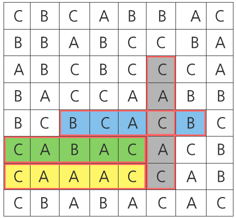

# SWEA 1215, 회문1 (성공)

# 문제 소개

[문제 사이트 하이퍼링크](https://swexpertacademy.com/main/code/problem/problemDetail.do?problemLevel=2&problemLevel=3&contestProbId=AV14QpAaAAwCFAYi&categoryId=AV14QpAaAAwCFAYi&categoryType=CODE&problemTitle=&orderBy=LASTEST_COMMENT&selectCodeLang=ALL&select-1=3&pageSize=10&pageIndex=1)

"기러기", "토마토", "스위스"와 같이 똑바로 읽어도 거꾸로 읽어도 똑같은 문장이나 낱말을 회문(回文, palindrome)이라 한다.8x8 평면 글자판에서 제시된 길이를 가진 회문의 개수를 구하라.



위와 같은 글자판이 주어졌을 때, 길이가 5인 회문은 붉은색 테두리로 표시된 4개이므로 4를 반환하면 된다

**[제약 사항]**각 칸의 들어가는 글자는 'A', 'B', 'C' 중 하나이다. ABA도 회문이며, ABBA도 회문이다. A 또한 길이 1짜리 회문이다.가로 또는 세로로 이어진 회문의 개수만 센다. 아래 그림에서 노란색 경로를 따라가면 길이 7짜리 회문이 되지만 직선이 아니기 때문에 인정되지 않는다.


**[입력]**

총 10개의 테스트 케이스가 주어진다.

각 테스트 케이스의 첫 번째 줄에는 찾아야 하는 회문의 길이가 주어지며, 다음 줄에 8x8 크기의 글자판이 주어진다.

**[출력]**

#부호와 함께 테스트 케이스의 번호를 출력하고, 공백 문자 후 찾은 회문의 개수를 출력한다.

```cpp
입력
4
CBBCBAAB
CCCBABCB
CAAAACAB
BACCCCAC
AABCBBAC
ACAACABC
BCCBAABC
ABBBCCAA
4
BCBBCACA
BCAAACAC
ABACBCCB
AACBCBCA
ACACBAAA
ACCACCCB
AACAAABA
CACCABCB
...
**출력**
#1 12
#2 10...
```

---

# 풀이 과정

- 8×8 격자에서 모든 경우를 찾아야 해서, 길이 L인 창으로 행과 열을 전부 검사하기로 했다.
- 처음엔 `map<string, int>`로 이미 센 회문인지 확인하려 했다.
- 행은 `substr`로 잘라내고, 열은 세로로 글자를 이어 붙여서 앞뒤를 비교했다 (약 22분).

```cpp
#include<iostream>
#include <string>
#include <vector>

using namespace std;

int main(int argc, char** argv)
{
	int test_case;

	for (test_case = 1; test_case <= 10; ++test_case) {
		int size, answer = 0;
		cin >> size;
		vector<string> arr(8);
		for (int i = 0; i < 8; i++) cin >> arr[i];

		// 행 검사: i번째 줄에서 시작점 j, 길이 size인 조각
		for (int i = 0; i < 8; i++) {
			for (int j = 0; j <= 8 - size; j++) {
				string check = arr[i].substr(j, size);

				// 앞에서 k번째 == 뒤에서 k번째 를 "절반까지만" 비교 → 홀수/짝수 구분 필요 없음
				bool flag = false;
				for (int k = 0; k < size / 2; k++) {
					if (check[k] != check[size - 1 - k]) { flag = true; break; }
				}
				if (!flag) answer++;
			}
		}

		// 열 검사: i번째 열에서 시작 행 j부터 size개를 세로로 이어 붙인 조각
		for (int i = 0; i < 8; i++) {
			for (int j = 0; j <= 8 - size; j++) {
				string check;
				for (int k = j; k < j + size; k++) check += arr[k][i];

				bool flag = false;
				for (int k = 0; k < size / 2; k++) {
					if (check[k] != check[size - 1 - k]) { flag = true; break; }
				}
				if (!flag) answer++;
			}
		}

		cout << "#" << test_case << " " << answer << '\n';
	}
	return 0;//정상종료시 반드시 0을 리턴해야합니다.
}

```

---

# 결과 & 근거

**성공 (약 22분)**

- 같은 글자의 회문이라도 위치가 다르면 따로 세야 해서, map으로 중복을 거를 필요가 없다.
- 앞뒤 비교는 절반까지만 하면 짝수·홀수 구분 없이 한 루프로 끝난다.

```cpp
// 더 깔끔한 코드
#include<iostream>
#include <string>
#include <vector>

using namespace std;

int main(int argc, char** argv)
{
	int test_case;

	for (test_case = 1; test_case <= 10; ++test_case) {
		int size, answer = 0;
		cin >> size;
		vector<string> arr(8);
		for (int i = 0; i < 8; i++) cin >> arr[i];

		// 행 검사: i번째 줄에서 시작점 j, 길이 size인 조각
		for (int i = 0; i < 8; i++) {
			for (int j = 0; j <= 8 - size; j++) {
				string check = arr[i].substr(j, size);

				// 앞에서 k번째 == 뒤에서 k번째 를 "절반까지만" 비교 → 홀수/짝수 구분 필요 없음
				bool flag = false;
				for (int k = 0; k < size / 2; k++) {
					if (check[k] != check[size - 1 - k]) { flag = true; break; }
				}
				if (!flag) answer++;
			}
		}

		// 열 검사: i번째 열에서 시작 행 j부터 size개를 세로로 이어 붙인 조각
		for (int i = 0; i < 8; i++) {
			for (int j = 0; j <= 8 - size; j++) {
				string check;
				for (int k = j; k < j + size; k++) check += arr[k][i];

				bool flag = false;
				for (int k = 0; k < size / 2; k++) {
					if (check[k] != check[size - 1 - k]) { flag = true; break; }
				}
				if (!flag) answer++;
			}
		}

		cout << "#" << test_case << " " << answer << '\n';
	}
	return 0;//정상종료시 반드시 0을 리턴해야합니다.
}
```

> 
> 
> 
> ***한 줄 요약***
> 
> **격자 문자열 슬라이딩 윈도우 문제.**
> 
>  8×8 판의 모든 행·열에서 길이 L인 조각을 잘라 앞뒤를 절반까지 비교하며 회문 개수를 센다. 위치가 다르면 따로 세는 것과, 절반 비교로 홀짝 분기를 없애는 게 핵심.
> 

### 알고리즘 분류

- 문자열
- 슬라이딩 윈도우
- 브루트포스