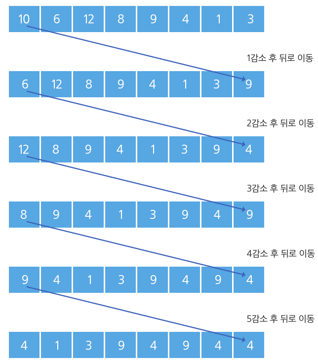

# SWEA 1225, 암호생성기 (성공)

# 문제 소개

[문제 사이트 하이퍼링크](https://swexpertacademy.com/main/code/problem/problemDetail.do?problemLevel=3&problemLevel=4&contestProbId=AV14uWl6AF0CFAYD&categoryId=AV14uWl6AF0CFAYD&categoryType=CODE&problemTitle=&orderBy=INQUERY_COUNT&selectCodeLang=ALL&select-1=4&pageSize=10&pageIndex=1)

다음 주어진 조건에 따라 n개의 수를 처리하면 8자리의 암호를 생성할 수 있다.

- 8개의 숫자를 입력 받는다.
- 첫 번째 숫자를 1 감소한 뒤, 맨 뒤로 보낸다. 다음 첫 번째 수는 2 감소한 뒤 맨 뒤로, 그 다음 첫 번째 수는 3을 감소하고 맨 뒤로, 그 다음 수는 4, 그 다음 수는 5를 감소한다.

이와 같은 작업을 한 사이클이라 한다.

- 숫자가 감소할 때 0보다 작아지는 경우 0으로 유지되며, 프로그램은 종료된다.
- 이 때의 8자리의 숫자 값이 암호가 된다.

[1 사이클]



[암호 도출]


**[제약 사항]**

주어지는 각 수는 integer 범위를 넘지 않는다.

마지막 암호 배열은 모두 한 자리 수로 구성되어 있다.

**[입력]**

총 10개의 테스트 케이스가 주어진다.

각 테스트 케이스의 첫 줄에는 테스트 케이스의 번호가 주어지고, 그 다음 줄에는 8개의 데이터가 주어진다.

```cpp
1
9550 9556 9550 9553 9558 9551 9551 9551
2
2419 2418 2423 2415 2422 2419 2420 2415
........
```

**[출력]**

#부호와 함께 테스트케이스의 번호를 출력하고, 공백 문자 후 테스트 케이스의 답을 출력한다.

```cpp
#1 6 2 2 9 4 1 3 0
#2 9 7 9 5 4 3 8 0
.......
```

---

# 풀이 과정

- 간단한 구현 문제이다.
    - 1~5 사이클을 돌려서 암호를 구하면 된다.
- 문제를 처음에 잘못 이해해서, 시간을 허비한 게 있었다.
    - 1만 뺀다는 거로 오해.

```cpp
#include <bits/stdc++.h>
#include<iostream>

using namespace std;

int main(int argc, char** argv) {
    int test_case;
    int T = 10;
    
    for (test_case = 1; test_case <= T; ++test_case) {
        int idx = 0;
        cin >> idx;
        
        queue<int> q;
        for (int i = 0; i < 8; i++) {
            int a;
            cin >> a;
            q.push(a);
        }

        bool flag = false;
        while (!flag) {
            for (int i = 1; i <= 5; i++) {
                int f = q.front();
                q.pop();
                if (f - i <= 0) {
                    q.push(0);
                    flag = true;
                    break;
                }
                q.push(f - i);
            }
        }
        
        cout << "#" << test_case << " ";
        while (!q.empty()) {
            cout << q.front() << " ";
            q.pop();
        }
        cout << endl;

        // 큐 출력, 25분 패스
    }
    return 0; //정상종료시 반드시 0을 리턴해야합니다.
}

```

---

# 결과 & 근거

- 일단 25분 만에 클리어.
- 만약에 숫자 범위가 0 이상 INTEGER 이하의 범위라면 해당 코드는 틀린 코드이다.
    - 핵심은 40회 연산마다 8개 원소가 전부 정확히 15씩 감소하고, 순서도 원래대로 돌아온다.

```cpp
#include <iostream>
#include <queue>
#include <algorithm>
#include <vector>
using namespace std;

int main() {
    ios::sync_with_stdio(false); cin.tie(nullptr);

    for (int tc = 1; tc <= 10; tc++) {          // 지문: 총 10개 테스트케이스 (입력에 T 없음)
        int idx; cin >> idx;                    // ★ 케이스 번호를 먼저 소비 (SWEA 포맷)

        vector<int> a(8);
        for (auto& x : a) cin >> x;

        /* ---- [선택] 벌크 건너뛰기. 지문 제한에선 불필요하지만 원리는 알아둘 값어치가 있다 ----
           40회 연산 = 전원 -15 + 순서 제자리.  최솟값이 1 이상으로 남는 만큼만 건너뛴다        */
        int mn = *min_element(a.begin(), a.end());
        long long k = (mn - 1) / 15;            // 15k <= mn-1  ->  건너뛴 뒤에도 최솟값 >= 1
        if (k > 0) for (auto& x : a) x -= 15 * k;

        queue<int> q;
        for (int x : a) q.push(x);

        bool done = false;
        while (!done) {
            for (int i = 1; i <= 5; i++) {      // ★ 한 사이클 = 1,2,3,4,5 를 차례로 뺀다
                int f = q.front(); q.pop();     //   맨 앞을 꺼내서
                if (f - i <= 0) {               //   0 이하가 되면
                    q.push(0);                  //     0 으로 밀어넣고
                    done = true;                //     종료
                    break;
                }
                q.push(f - i);                  //   아니면 i 를 뺀 값을 맨 뒤로
            }
        }

        cout << "#" << tc;
        while (!q.empty()) { cout << " " << q.front(); q.pop(); }   // ★ 공백을 앞에 붙여 trailing space 제거
        cout << "\n";
    }
    return 0;
}
```

> 
> 
> 
> **한 줄 요약**
> 
> 큐 회전 시뮬레이션 문제. 
> 
> 맨 앞 수를 꺼내 1→2→3→4→5를 순환하며 빼고 맨 뒤로 보내는 것을 반복하다, 결과가 0 이하가 되면 0으로 밀고 종료한다. queue의 pop+push가 "앞에서 뒤로 보내기"와 정확히 맞아떨어지는 것이 핵심이며, for의 break와 while의 플래그가 한 쌍이어야 전체가 종료된다.
> 

### 알고리즘 분류

- 구현
- 큐