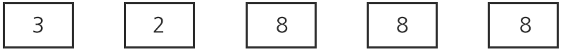

# SWEA 1244, 최대 상금 (실패)

# 문제 소개

[문제 사이트 하이퍼링크](https://swexpertacademy.com/main/code/problem/problemDetail.do?problemLevel=2&problemLevel=3&contestProbId=AV15Khn6AN0CFAYD&categoryId=AV15Khn6AN0CFAYD&categoryType=CODE&problemTitle=&orderBy=SUBMIT_COUNT&selectCodeLang=ALL&select-1=3&pageSize=10&pageIndex=1)

퀴즈 대회에 참가해서 우승을 하게 되면 보너스 상금을 획득할 수 있는 기회를 부여받는다.

우승자는 주어진 숫자판들 중에 두 개를 선택에서 정해진 횟수만큼 서로의 자리를 위치를 교환할 수 있다.

예를 들어, 다음 그림과 3, 2, 8, 8, 8 의 5개의 숫자판들이 주어지고 교환 횟수는 2회라고 하자.

교환전>



처음에는 첫번째 숫자판의 3과 네 번째 숫자판의 8을 교환해서 8, 2, 8, 3, 8이 되었다.


다음으로, 두 번째 숫자판 2와 마지막에 있는 8을 교환해서 8, 8, 8, 3, 2이 되었다.


정해진 횟수만큼 교환이 끝나면 숫자판의 위치에 부여된 가중치에 의해 상금이 계산된다.

숫자판의 오른쪽 끝에서부터 1원이고 왼쪽으로 한자리씩 갈수록 10의 배수만큼 커진다.

위의 예에서와 같이 최종적으로 숫자판들이 8,8,8,3,2의 순서가 되면 88832원의 보너스 상금을 획득한다.

여기서 주의할 것은 반드시 횟수만큼 교환이 이루어져야 하고 동일한 위치의 교환이 중복되어도 된다.

다음과 같은 경우 1회의 교환 횟수가 주어졌을 때 반드시 1회 교환을 수행하므로 결과값은 49가 된다.


94의 경우 2회 교환하게 되면 원래의 94가 된다.

정해진 횟수만큼 숫자판을 교환했을 때 받을 수 있는 가장 큰 금액을 계산해보자.

**[입력]**

가장 첫 줄은 전체 테스트 케이스의 수이다. 최대 10개의 테스트 케이스가 표준 입력을 통하여 주어진다.

각 테스트 케이스에는 숫자판의 정보와 교환 횟수가 주어진다. 숫자판의 정보는 정수형 숫자로 주어지고 **최대 자릿수** 는 6자리이며, **최대 교환 횟수** 는 10번이다.

**[출력]**

각 테스트 케이스마다, 첫 줄에는 “#C”를 출력해야 하는데 C는 케이스 번호이다. 같은 줄에 빈 칸을 하나 사이에 두고 교환 후 받을 수 있는 가장 큰 금액을 출력한다.

```cpp
입력
3
123 1
2737 1
32888 2
. . .
**출력**
#1 321
#2 7732
#3 88832
. . .
```

---

# 풀이 과정

- 앞자리부터 뒤에서 찾은 최댓값과 바꾸고, 다음 바꿀 위치를 하나씩 옮기는 방식을 생각했다.
- 제일 작은 값이 교환 횟수 안에 바뀔 자리면 건너뛰어야 하는 등 바꿀 자리 선정에서 꼬여서 30분에 포기했다.
- 시간을 더 들이면 완전 탐색으로 구현할 수 있을 것 같았다.

```cpp
#include<iostream>
#include <vector>

using namespace std;

/*
퀴즈 대회 참가 -> 우승 시 보너스 상금 획득 기회!
- 우승자는 주어진 숫자판들 중에 두 개를 선택에서 정해진 횟수만큼 서로의 자리를 위치를 교환할 수 있다.
- 정해진 횟수만큼 교환이 끝나면 숫자판의 위치에 부여된 가중치에 의해 상금이 계산
- 숫자판의 오른쪽 끝에서부터 1원이고 왼쪽으로 한자리씩 갈수록 10의 배수
- 반드시 횟수만큼 교환이 이루어져야 하고 동일한 위치의 교환이 중복되어도 된다. (94 -> 교환 2번 = 94)

*/
int main(int argc, char** argv)
{
	int test_case;
	int T;
	/*
	   여러 개의 테스트 케이스가 주어지므로, 각각을 처리합니다.
	*/
	cin >> T;
	for (test_case = 1; test_case <= T; ++test_case) {
		//  최대 자릿수는 6자리이며, 최대 교환 횟수는 10번
		string num;
		int cnt;

		vector<int> v;

		cin >> num >> cnt;

		for (int i = 0; i < num.size(); i++) {
			v.push_back(num[i] - '0');
		}

		// 바꿀 자리.
		int change_idx = 0;
		for (int i = 0; i < cnt; i++) {

			// 뒤에서부터 최댓값 찾기.
			int max_num=0, max_idx;
			for (int j = 0; j < v.size(); j++) {
				if (max_num <= v[j]) {
					max_num = v[j], max_idx = j;
				}
			}

			if (max_idx == change_idx) {
				continue;
			}
			else {

			}
			change_idx++;
			
		}

		/*max_n = *max_element(v.rbegin(), v.rend());
		max_i = max_element(v.rbegin(), v.rend()) - v.rbegin() + v.size() - 1;

		cout << "max_n, max_i: " << max_n << " " << max_i << endl;*/

		/*
		정해짓 횟수 만큼, 숫자끼리 교환을 해서 최대 상금을 만들어야 한다.
		생각나는 아이디어: 0자리 부터 최대값과 최솟값을 switching?
		- 

		12534 -> 2번 내로 바꾼다 해보자.
		1. 5가 끝으로 와야 함 -> 52134
		2. 4가 끝으로 와야 함 -> 54132

		어쨌든 0부터 쭈루룩 바꿔야 함. 
		대충 생각나는 게 일단 max를 찾고, 제일 작은 값과 그 자리를 찾아. 
		- max는 뒤에서부터 주루룩 찾아야 한다.
		- 대신 제일 작은 값이 교환 횟수 내에 바뀔 자리면 스킵해서 다음 작은 걸 찾아야 함.
		- 갱신 변수는 제일 큰 값 + 다음 바꿀 위치.

		32888 기준
		1. max = 8, idx = 3, 교환 횟수 = 2
		*/

	}
	return 0;//정상종료시 반드시 0을 리턴해야합니다.
}
```

---

# 결과 & 근거

**실패 (30분 포기)**

- 교환 횟수를 정확히 다 써야 하고 같은 숫자가 여러 개일 때 어느 것과 바꾸느냐가 중요해서, 그리디로는 안 된다.
- 최대 6자리, 최대 10번이라 DFS로 모든 교환을 시도하되, 같은 깊이에서 같은 숫자판 상태는 한 번만 탐색하면 충분히 빠르다.

```cpp
#include <iostream>
#include <string>
#include <set>
#include <vector>
#include <algorithm>

using namespace std;

string best;                  // 지금까지 찾은 최대 상금 (자릿수가 같으니 문자열 비교 = 숫자 비교)
int cnt;                      // 정확히 해야 하는 교환 횟수
vector<set<string>> visited;  // visited[d] = d번 교환한 시점에 이미 본 숫자판 상태들

void dfs(string cur, int depth) {
	if (depth == cnt) {               // 교환을 정확히 cnt번 마침
		best = max(best, cur);
		return;
	}
	// 같은 깊이에서 같은 상태를 또 만나면, 그 뒤의 결과도 똑같으므로 건너뛴다 (중복 제거)
	if (visited[depth].count(cur)) return;
	visited[depth].insert(cur);

	// 모든 (i, j) 쌍을 한 번씩 교환해 본다 (자릿수 ≤ 6 → 최대 15쌍)
	for (int i = 0; i < cur.size(); i++) {
		for (int j = i + 1; j < cur.size(); j++) {
			swap(cur[i], cur[j]);
			dfs(cur, depth + 1);
			swap(cur[i], cur[j]);     // 원상 복구 (백트래킹)
		}
	}
}

int main(int argc, char** argv)
{
	int test_case;
	int T;
	cin >> T;

	for (test_case = 1; test_case <= T; ++test_case) {
		string num;
		cin >> num >> cnt;

		best = "";
		visited.assign(cnt + 1, set<string>());   // 테스트 케이스마다 초기화
		dfs(num, 0);

		cout << "#" << test_case << " " << best << '\n';
	}
	return 0;//정상종료시 반드시 0을 리턴해야합니다.
}

```

> 
> 
> 
> ***한 줄 요약***
> 
> **DFS 완전 탐색 + 중복 상태 제거 문제.** 
> 
> 모든 두 자리 쌍을 교환하며 정확히 K번 깊이까지 내려가고, 같은 깊이에서 이미 본 숫자판 상태는 다시 탐색하지 않아 최대 상금을 구한다. 작은 범위를 보고 그리디 대신 전수 + (깊이, 상태) 중복 제거로 가는 게 핵심.
> 

### 알고리즘 분류

- DFS
- 백트래킹
- 브루트포스