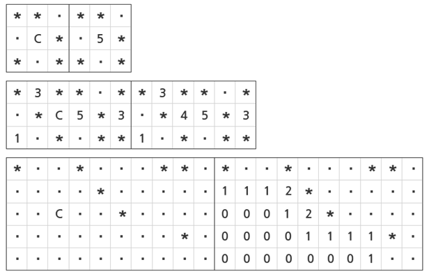

# SWEA 1868, 파핑파핑 지뢰찾기 (실패)

# 문제 소개

[문제 사이트 하이퍼링크](https://swexpertacademy.com/main/code/problem/problemDetail.do?contestProbId=AV5LwsHaD1MDFAXc)

‘파핑 파핑 지뢰 찾기’라는 유명한 게임이 있다. 이 게임은 RXC 크기의 표를 이용하는 게임인데,표의 각 칸에는 지뢰가 있을 수도 있고 없을 수도 있다. 표의 각 칸을 클릭했을 때, 그 칸이 지뢰가 있는 칸이라면 ‘파핑 파핑!’이라는 소리와 함께 게임은 끝난다. 지뢰가 없는 칸이라면 변이 맞닿아 있거나 꼭지점이 맞닿아 있는 최대 8칸에 대해 몇 개의 지뢰가 있는지가 0에서 8사이의 숫자로 클릭한 칸에 표시된다. 

만약 이 숫자가 0이라면 근처의 8방향에 지뢰가 없다는 것이 확정된 것이기 때문에 그 8방향의 칸도 자동으로 숫자를 표시해 준다. 

실제 게임에서는 어떤 위치에 지뢰가 있는지 알 수 없지만, 이 문제에서는 특별히 알 수 있다고 하자.지뢰를 ‘*’로, 지뢰가 없는 칸을 ‘.’로, 클릭한 지뢰가 없는 칸을 ‘c’로 나타냈을 때 표가 어떻게 변화되는지 나타낸다.



세 번째 예에서는 0으로 표시 될 칸들과 이와 인접한 칸들이 한 번의 클릭에 연쇄적으로 숫자가 표시된 것을 볼 수 있다.

파핑 파핑 지뢰 찾기를 할 때 표의 크기와 표가 주어질 때, 지뢰가 있는 칸을 제외한 다른 모든 칸의 숫자들이 표시되려면 최소 몇 번의 클릭을 해야 하는지 구하는 프로그램을 작성하라.

**[입력]**

첫 번째 줄에 테스트 케이스의 수 T가 주어진다.

각 테스트 케이스의 첫 번째 줄에 하나의 정수 N(1 ≤ N ≤ 300) 이 주어진다. 이는 지뢰 찾기를 하는 표의 크기가 N*N임을 나타낸다.

다음 N개의 줄의 i번째 줄에는 길이가 N인 문자열이 주어진다.

이 중 j번째 문자는 표에서 i번째 행 j번째 열에 있는 칸이 지뢰가 있는 칸인지 아닌지를 나타낸다.

‘*’이면 지뢰가 있다는 뜻이고, ‘.’이면 지뢰가 없다는 뜻이다. ‘*’와 ‘.’외의 다른 문자는 입력으로 주어지지 않는다.

```cpp
2
3
..*
..*
**.
5
..*..
..*..
.*..*
.*...
.*...
```

**[출력]**

각 테스트 케이스마다 ‘#x’(x는 테스트케이스 번호를 의미하며 1부터 시작한다)를 출력하고,

최소 몇 번의 클릭을 해야 지뢰가 없는 모든 칸에 숫자가 표시될 것인지 출력한다.

---

# 풀이 과정

- 8방향 탐색이라는 건 바로 파악했다. 방향 배열도 맞게 짰다.
- 핵심은 사실 **클릭 순서**다. 주변 지뢰가 0 이 아닌 칸을 클릭하면 **그 칸만** 열리므로, **0 인 칸부터 전부 터뜨린 뒤** 남은 칸을 하나씩 클릭해야 최소가 된다.
- 왜 최적인가는 다음과 같아
    - 0-연결덩어리는 그 안의 칸을 클릭해야만 열린다 (0 이 아닌 칸 클릭은 연쇄가 없으므로).
    - 따라서 덩어리당 최소 1회 필요하고 1회로 충분하다.
- 전파 규칙: 0 인 칸에서는 8방향으로 계속 퍼지고, **0 이 아닌 칸은 열기만 하고 멈춘다.**
- 덩어리 수는 **BFS 를 호출한 횟수**로 센다. 전역 변수가 필요 없다 (연결 요소 세기 패턴).

```cpp

vector<vector<char>> arr;
vector<vector<int>> visited;
vector<pair<int, int>> safe;

void bfs(int n, int sx, int sy, vector<vector<char>>& arr, vector<vector<int>> visited) {
    queue<pair<int, int>> q;

    // 좌하단 시작 반시계 방향
    int dx[8] = {1, 1, 1, 0, -1, -1, -1, 0};
    int dy[8] = {-1, 0, 1, 1, 1, 0, -1, -1};

    q.push({sx, sy});

    while (!q.empty()) {
        pair<int, int> p = q.front();
        q.pop();

        if (visited[p.first][p.second] != 0) {
            // 이미 방문한 것, 주변 지뢰 숫자가 표시됨
            continue;
        }

        int mine = 0;

        // 주변 8칸에 지뢰가 있는 경우 counting + visited 처리 + 현 자리 숫자로 표시 + return.
        for (int j = 0; j < 8; j++) {
            int nx = p.first + dx[j], ny = p.second + dy[j];

            if (nx < 0 || nx >= n || ny < 0 || ny >= n) continue;

            if (arr[nx][ny] == '*') mine++;
        }

        if (mine != 0) {
            char m = mine + '0';
            cout << p.first << " " << p.second << "에 " << m << "을 저장합니다" << endl;
            arr[p.first][p.second] = m;
        }
        else {
            // 깔끔한 것
            // arr[p.first][p.second] = '.';
            q.push({});
        }
    }
}

int main(int argc, char** argv) {
    int answer = 0;
    int test_case;
    int T;
    cin >> T;

    for (test_case = 1; test_case <= T; ++test_case) {
        int n;
        cin >> n;

        arr.assign(n, vector<char>(n));
        visited.assign(n, vector<int>(n));

        for (int i = 0; i < n; ++i) {
            string s;
            cin >> s;
            for (int j = 0; j < n; ++j) {
                arr[i][j] = s[j];
                if (s[j] == '.') {
                    safe.push_back({i, j});
                    // q.push({i, j});
                }
            }

            // BFS

            for (auto [x, y] : safe) {
                if (visited[x][y]) {
                    continue;
                }
                bfs(n, x, y, arr, visited);
                answer++;
            }

        }
    }

    return answer; //정상종료시 반드시 0을 리턴해야합니다.
}
```

---

# 결과 & 근거

- 실패 (무한 루프, 25분)
- 이유
    - `q.push({p.first, p.second})` — 이웃이 아니라 자기 자신을 다시 넣었다.
    - `visited` 를 값으로 전달했다 (`arr` 는 `&`, `visited` 는 아님).
    - BFS 루프가 입력 읽는 루프 안에 있었다

```cpp
#include <iostream>
#include <vector>
#include <string>
#include <queue>
using namespace std;

/*
 * SWEA 1868 파핑파핑 지뢰찾기
 * 상태와 전이 : 주변 지뢰 0 인 칸의 연결 덩어리마다 클릭 1회로 덩어리+테두리가 열린다.
 *               남은 안전칸은 각각 1회.
 * (멀티 테스트케이스) 루프마다 초기화할 것 : grid, open, clicks
 */

int dx8[8] = {1, 1, 1, 0, -1, -1, -1, 0};      // 좌하단 시작 반시계 (네 배열 그대로 — 맞다)
int dy8[8] = {-1, 0, 1, 1, 1, 0, -1, -1};

int main() {
    ios::sync_with_stdio(false); cin.tie(nullptr);

    int T; cin >> T;
    for (int tc = 1; tc <= T; tc++) {
        int n; cin >> n;

        /* ★ 입력을 "전부" 읽은 뒤에 계산을 시작한다 */
        vector<string> g(n);
        for (int i = 0; i < n; i++) cin >> g[i];

        vector<vector<char>> open(n, vector<char>(n, 0));   // ★ 지역 변수 + 매번 새로 만든다
        int clicks = 0;                                     // ★ 테스트케이스마다 초기화

        /* 주변 8칸의 지뢰 수 — 람다로 두면 전역 함수가 필요 없다 */
        auto mineCount = [&](int x, int y) {
            int c = 0;
            for (int k = 0; k < 8; k++) {
                int nx = x + dx8[k], ny = y + dy8[k];
                if (nx < 0 || nx >= n || ny < 0 || ny >= n) continue;
                if (g[nx][ny] == '*') c++;
            }
            return c;
        };

        /* 1단계 — 주변 지뢰 0 인 칸에서 BFS. 호출 횟수 = 덩어리 수 */
        for (int i = 0; i < n; i++) for (int j = 0; j < n; j++) {
            if (g[i][j] == '*' || open[i][j]) continue;
            if (mineCount(i, j) != 0) continue;              // ★ 0 인 칸에서만 시작한다

            clicks++;                                        // ★ BFS 호출 횟수를 세면 끝이다
                                                             //   (전역 변수가 필요 없다)
            queue<pair<int,int>> q;
            q.push({i, j});
            open[i][j] = 1;                                  // ★ push 하는 순간 열었다고 표시

            while (!q.empty()) {
                auto [x, y] = q.front(); q.pop();

                if (mineCount(x, y) != 0) continue;           // ★ 0 이 아니면 여기서 전파 중단
                                                             //   (이미 열려 있고, 더 퍼지지 않는다)
                for (int k = 0; k < 8; k++) {
                    int nx = x + dx8[k], ny = y + dy8[k];
                    if (nx < 0 || nx >= n || ny < 0 || ny >= n) continue;
                    if (g[nx][ny] == '*' || open[nx][ny]) continue;
                    open[nx][ny] = 1;                         // ★ 이웃을 열고
                    q.push({nx, ny});                         // ★ 이웃을 넣는다 (자기가 아니다)
                }
            }
        }

        /* 2단계 — 0 전파로 안 열린 안전칸은 하나씩 클릭 */
        for (int i = 0; i < n; i++) for (int j = 0; j < n; j++)
            if (g[i][j] != '*' && !open[i][j]) clicks++;

        cout << "#" << tc << " " << clicks << "\n";           // ★ return 이 아니라 출력
    }
    return 0;
}
```

### 알고리즘 분류

- BFS
- 플러드 필 / 연결 요소
- 그리디 (클릭 순서)