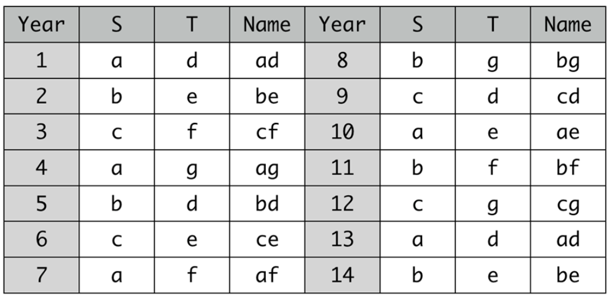

# 문제 소개

문제 사이트 하이퍼링크

육십갑자 체계를 일반화한 다음과 같은 상황을 생각해 보자. N개의 문자열 s1, s2, s3 …, sN 과 M개의 문자열 t1, t2, t3, …, tM 이 있다. 이들은 알파벳 소문자로만 이루어져 있다. 

1년은 두 문자열 s1, t1 을 이어붙인 이름을 가지고, 그 다음 해는 각각의 문자열 리스트에서 다음 순서에 해당되는 문자열을 이어붙인 이름을 가진다. 

만약 리스트에서 다음 순서가 없다면, 첫 원소로 돌아간다.



예를 들어, N = 3, M = 4, s = {“a”, “b”, “c”}, t = {“d”, “e”, “f”, “g”} 라고 하면 매년 아래 표처럼 이름이 붙여진다. 일반적인 육십갑자 체계는 N = 10, M = 12 를 만족한다.

**[입력]**

첫 번째 줄에 테스트 케이스의 수 TC가 주어진다. 이후 TC개의 테스트 케이스가 새 줄로 구분되어 주어진다. 각 테스트 케이스는 다음과 같이 구성되었다.

- 첫 번째 줄에는 각 문자열 리스트의 길이 N, M 이 주어진다. (1 ≤ N,M≤20)
- 다음 줄에는 N개의 문자열 s1, s2… sn이 주어진다.
- 다음 줄에는 M개의 문자열 t1, t2 .. tm이 주어진다.
- 다음 줄에는 정수 Q 가 주어진다.(1≤Q≤2020)
- 다음 Q개의 줄에는 이름을 알고 싶은 년도 Y가 주어진다.(1≤Y≤10^9)
- 주어지는 문자열들은 알파벳 소문자로만 이루어져 있고 그 길이가 10을 넘지 않는다.

**[출력]**

각 테스트 케이스 마다 한 줄씩, 이름에 해당하는 Q개의 문자열을 입력 순서대로 출력하라.

```cpp
입력
1
10 12
sin im gye gap eul byeong jeong mu gi gyeong
yu sul hae ja chuk in myo jin sa o mi sin
7
1
2
3
4
2018
2019
2020

출력
#1 sinyu imsul gyehae gapja musul gihae gyeongja
```

---

# 풀이 과정

- 두 문자열 리스트가 각자 따로 돌다가 끝나면 처음으로 돌아가니까, 연도를 각 리스트 길이로 나눈 나머지로 위치를 구하면 된다고 봤다.
- 1년이 첫 번째 원소라서 (a - 1) % n, (a - 1) % m으로 인덱스를 맞추고, 두 문자열을 이어 붙여 공백과 함께 출력했다.
- 20분 안에 통과했다.

```cpp
#include<iostream>
#include <vector>

using namespace std;

/*
25분 시작.

19185. 육십갑자
- n, m : 알파벳 소문자.
- 1년은 두 문자열 s1, t1
- 각각의 문자열 리스트에서 다음 순서에 해당되는 문자열을 이어붙인 이름을 가진다
- 만약 리스트에서 다음 순서가 없다면, 첫 원소로 돌아간다
-  N = 3, M = 4, s = {“a”, “b”, “c”}, t = {“d”, “e”, “f”, “g”} 라고 하면 매년 아래 표처럼 이름이 붙여진다

- 일반적인 육십갑자 체계는 N = 10, M = 12 를 만족한다.
*/

int main(int argc, char** argv)
{
	int test_case;
	int T;

	cin >> T;

	for (test_case = 1; test_case <= T; ++test_case)
	{
		int n, m, q;
		cin >> n >> m;

		vector<string> nv, mv;
		for (int i = 0; i < n; i++) {
			string s;
			cin >> s;
			nv.push_back(s);
		}
		for (int i = 0; i < m; i++) {
			string s;
			cin >> s;
			mv.push_back(s);
		}

		cin >> q;

		

		string answer;
		for (int i = 0; i < q; i++) {
			int a;
			cin >> a;

			answer += nv[(a - 1) % n] + mv[(a - 1) % m] +  " ";
		}

		cout << "#" << test_case << " " << answer << endl;

	}
	return 0; 
}
```

---

# 결과 & 근거

**성공 (20분 이내)**

- 두 리스트는 서로 독립적으로 돌기 때문에 연도 Y의 이름은 s[(Y - 1) % N] + t[(Y - 1) % M]이다.
- Y가 최대 10^9여도 나머지만 구하면 되니 반복할 필요가 없다.
- 출력할 때 공백을 값 앞에 붙이면 줄 끝에 공백이 남지 않는다.

```cpp
#include<iostream>
#include <vector>
#include <string>

using namespace std;

int main(int argc, char** argv)
{
	ios::sync_with_stdio(false);
	cin.tie(nullptr);

	int test_case;
	int T;
	cin >> T;

	for (test_case = 1; test_case <= T; ++test_case)
	{
		int n, m, q;
		cin >> n >> m;

		vector<string> nv(n), mv(m);
		for (int i = 0; i < n; i++) cin >> nv[i];
		for (int i = 0; i < m; i++) cin >> mv[i];

		cin >> q;

		cout << "#" << test_case;
		for (int i = 0; i < q; i++) {
			int a;   // 최대 10^9 → int 범위(약 21억) 안
			cin >> a;

			// 1년이 0번 인덱스 → (a - 1)로 0부터 세게 맞춘 뒤, 각 리스트 길이로 나눈 나머지가 위치
			// 두 리스트는 서로 독립적으로 돈다 (n, m이 달라도 상관없음)
			cout << " " << nv[(a - 1) % n] + mv[(a - 1) % m];
		}
		cout << '\n';   // 공백을 "앞에" 붙여서 줄 끝에 공백이 남지 않는다
	}
	return 0;//정상종료시 반드시 0을 리턴해야합니다.
}
```

> 
> 
> 
> ***한 줄 요약***
> 
> **나머지 연산 문제.** 
> 
> 연도에서 1을 빼 0부터 세게 맞춘 뒤, 두 리스트 길이로 각각 나눈 나머지로 위치를 구해 이어 붙인다. 두 리스트가 독립적으로 돈다는 것과 (Y - 1)로 인덱스를 맞추는 게 핵심.
> 

### 알고리즘 분류

- 수학
- 구현
- 문자열