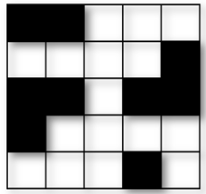

# SWEA 1979, 어디에 단어가 들어갈 수 있을까 (실패)

# 문제 소개

[문제 사이트 하이퍼링크](https://swexpertacademy.com/main/code/problem/problemDetail.do?problemLevel=2&problemLevel=3&contestProbId=AV5PuPq6AaQDFAUq&categoryId=AV5PuPq6AaQDFAUq&categoryType=CODE&problemTitle=&orderBy=RECOMMEND_COUNT&selectCodeLang=ALL&select-1=3&pageSize=10&pageIndex=1)

N X N 크기의 단어 퍼즐을 만들려고 한다. 입력으로 단어 퍼즐의 모양이 주어진다.

주어진 퍼즐 모양에서 특정 길이 K를 갖는 단어가 들어갈 수 있는 자리의 수를 출력하는 프로그램을 작성하라.

**[예제]**

N = 5, K = 3 이고, 퍼즐의 모양이 아래 그림과 같이 주어졌을 때



길이가 3 인 단어가 들어갈 수 있는 자리는 2 곳(가로 1번, 가로 4번)이 된다.


**[제약 사항]**

1. N은 5 이상 15 이하의 정수이다. (5 ≤ N ≤ 15)

2. K는 2 이상 N 이하의 정수이다. (2 ≤ K ≤ N)

**[입력]**

입력은 첫 줄에 총 테스트 케이스의 개수 T가 온다.

다음 줄부터 각 테스트 케이스가 주어진다.

테스트 케이스의 첫 번째 줄에는 단어 퍼즐의 가로, 세로 길이 N 과, 단어의 길이 K 가 주어진다.

테스트 케이스의 두 번째 줄부터 퍼즐의 모양이 2차원 정보로 주어진다.

퍼즐의 각 셀 중, 흰색 부분은 1, 검은색 부분은 0 으로 주어진다.

**[출력]**

테스트 케이스 t에 대한 결과는 “#t”을 찍고, 한 칸 띄고, 정답을 출력한다.

(t는 테스트 케이스의 번호를 의미하며 1부터 시작한다.)

```cpp
입력
10
5 3
0 0 1 1 1
1 1 1 1 0
0 0 1 0 0
0 1 1 1 1
1 1 1 0 1
5 3
1 0 0 1 0
1 1 0 1 1
1 0 1 1 1
0 1 1 0 1
0 1 1 1 0
…
출력
#1 2
#2 6
...
```

---

# 풀이 과정

- 행과 열을 모두 검사해야 하고, 길이 K인 창 안의 1의 개수가 K인지 세는 슬라이딩 윈도우로 접근했다.
- 열은 열 전체 합이 K일 때만 창을 검사했다.
- 슬라이딩 윈도우 인덱싱에서 많이 꼬였고, 첫 예제 손코딩부터 틀려서 35분에 포기했다.

```cpp
#include<iostream>
#include <vector>

using namespace std;

/*
N*N 정사각형 단어 퍼즐 만들기!
- 특정 길이 K를 갖는 단어가 들어갈 수 있는 자리 수를 출력하는 프로그램 만들기
- 흰색 부분은 1, 검은색 부분은 0 
- 5 <= N <= 15
- 2 <= K <= N

일단 입력
- 검사: 행/열 모두 검사해야 한다
- 검사 조건: 먼저 1의 크기가 같은가? -> 슬라이딩 윈도우 식으로 1의 갯수 검사 해서 0 포함 유무 검사

*/

int main(int argc, char** argv)
{
	int test_case;
	int T;

	cin >> T;
	/*
	   여러 개의 테스트 케이스가 주어지므로, 각각을 처리합니다.
	*/
	for (test_case = 1; test_case <= T; ++test_case)
	{
		int n, k, answer = 0;
		cin >> n >> k;

		vector<vector<int>> puzzle(n);

		for (int i = 0; i < n; i++) {
			int a;
			for (int j = 0; j < n; j++) {
				cin >> a;
				puzzle[i].push_back(a);
			}
		}

		// 행 검사
		for (int i = 0; i < n; i++) {

			for (int j = 0; j <= n - k; j++) {
				int window_total = 0;

				for (int l = j; l < j + k; l++) {
					window_total += puzzle[i][l];
				}
				if (window_total == k) { // 1의 갯수, 흰 박스가 원하는 단어 길이와 같은 것.
					cout << "row" << i << " " << j << "~" << j + k << "can word!" << endl;
					answer++;
				}

			}
		}

		// 열 검사
		for (int i = 0; i < n; i++) {
			int total = 0;
			for (int j = 0; j < n; j++) { // 열 합 구하기
				total += puzzle[j][i];
			}

			if (total == k) {
				
				for (int j = 0; j <= n-k; j++) { // 열 합 구하기
					int window_total = 0;
					for (int l = j; l < j + k; l++) {
						window_total += puzzle[l][i];
					}
					if (window_total == k) { // 1의 갯수, 흰 박스가 원하는 단어 길이와 같은 것.
						cout << "col" << i << " " << j << "~" << j + k << "can word!" << endl;
						answer++;
					}
				}
				 
			}
		}

		cout << "#" << test_case << " " << answer << endl;

		cout << "\n-------------------------------\n\n";

		/*
		20분 슬라이딩 윈도우에서 막힘
		
		*/
	}
	return 0;//정상종료시 반드시 0을 리턴해야합니다.
}
```

---

# 결과 & 근거

**실패 (35분 포기)**

- 단어가 들어갈 수 있는 자리 = 연속한 흰칸(1)이 정확히 K개인 곳이다. 창 안이 전부 1이어도, 창 바로 앞이나 뒤가 1이면 칸이 남아서 안 된다.
- 창 양 끝 바로 바깥이 벽이거나 0인지 확인하는 조건을 추가하면 기존 슬라이딩 윈도우 구조로 풀린다.
- 열 합이 K일 때만 보는 전제 조건은 한 열에 자리가 두 개 이상인 경우를 놓쳐서 빼야 한다.

```cpp
#include<iostream>
#include <vector>

using namespace std;

int main(int argc, char** argv)
{
	int test_case;
	int T;

	cin >> T;
	for (test_case = 1; test_case <= T; ++test_case) {
		int n, k, answer = 0;
		cin >> n >> k;

		vector<vector<int>> puzzle(n, vector<int>(n));
		for (int i = 0; i < n; i++)
			for (int j = 0; j < n; j++)
				cin >> puzzle[i][j];

		// 행 검사: i행에서 시작 열 j, 길이 k인 창
		for (int i = 0; i < n; i++) {
			for (int j = 0; j <= n - k; j++) {
				int window_total = 0;
				for (int l = j; l < j + k; l++) window_total += puzzle[i][l];

				// ① 창 안이 전부 흰칸(1)이고
				// ② 왼쪽 끝 바로 앞이 벽(j == 0)이거나 검은칸(0)이고
				// ③ 오른쪽 끝 바로 뒤가 벽(j + k == n)이거나 검은칸(0)이어야
				//    → "연속한 흰칸이 정확히 k개" = 단어가 딱 맞게 들어가는 자리
				bool left_closed = (j == 0) || (puzzle[i][j - 1] == 0);
				bool right_closed = (j + k == n) || (puzzle[i][j + k] == 0);

				if (window_total == k && left_closed && right_closed) answer++;
			}
		}

		// 열 검사: 행/열만 바꿔서 똑같이 (열 합 == k 전제 조건은 삭제)
		for (int i = 0; i < n; i++) {
			for (int j = 0; j <= n - k; j++) {
				int window_total = 0;
				for (int l = j; l < j + k; l++) window_total += puzzle[l][i];

				bool top_closed = (j == 0) || (puzzle[j - 1][i] == 0);
				bool bottom_closed = (j + k == n) || (puzzle[j + k][i] == 0);

				if (window_total == k && top_closed && bottom_closed) answer++;
			}
		}

		cout << "#" << test_case << " " << answer << '\n';
	}
	return 0;//정상종료시 반드시 0을 리턴해야합니다.
}

```

> 
> 
> 
> ***한 줄 요약***
> 
> **격자 연속 구간 문제.** 
> 
> 행과 열마다 길이 K인 창이 전부 흰칸이면서 양 끝 바로 바깥이 벽이나 검은칸인 자리를 센다. "창이 꽉 찼다"가 아니라 "연속 길이가 정확히 K"라는 조건이 핵심.
> 

### 알고리즘 분류

- 구현
- 격자
- 슬라이딩 윈도우