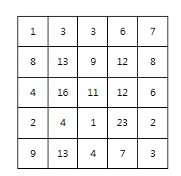

# SWEA 2001, 파리 퇴치 (성공)

# 문제 소개

[문제 사이트 하이퍼링크](https://swexpertacademy.com/main/code/problem/problemDetail.do?problemLevel=2&problemLevel=3&problemLevel=4&contestProbId=AV5PzOCKAigDFAUq&categoryId=AV5PzOCKAigDFAUq&categoryType=CODE&problemTitle=&orderBy=INQUERY_COUNT&selectCodeLang=ALL&select-1=4&pageSize=10&pageIndex=1)

N x N 배열 안의 숫자는 해당 영역에 존재하는 파리의 개수를 의미한다.

아래는 N=5 의 예이다.



M x M 크기의 파리채를 한 번 내리쳐 최대한 많은 파리를 죽이고자 한다.

죽은 파리의 개수를 구하라!


예를 들어 M=2 일 경우 위 예제의 정답은 49마리가 된다.

**[제약 사항]**

1. N 은 5 이상 15 이하이다.

2. M은 2 이상 N 이하이다.

3. 각 영역의 파리 갯수는 30 이하 이다.

**[입력]**

가장 첫 줄에는 테스트 케이스의 개수 T가 주어지고, 그 아래로 각 테스트 케이스가 주어진다.

각 테스트 케이스의 첫 번째 줄에 N 과 M 이 주어지고,

다음 N 줄에 걸쳐 N x N 배열이 주어진다.

**[출력]**

출력의 각 줄은 '#t'로 시작하고, 공백을 한 칸 둔 다음 정답을 출력한다.

(t는 테스트 케이스의 번호를 의미하며 1부터 시작한다.)

---

# 풀이 과정

- 단순한 구현 문제이다.
- 전체 좌표를 순회하면서 파리채가 들어가는 경우에 대해서만 값을 구한다.
- 20분 만에 성공
    - 격자 순회에서 갑자기 멘붕 + 헷갈렸다.
    - 그래서 그냥 N과 M 값이 작은 걸 이용해서 전체 무식 순회로 구하였다.

```cpp
#include<iostream>
#include <vector>

using namespace std;

int n, m;

int main(int argc, char** argv) {
    int test_case;
    int T;

    
    cin >> T;

    for (test_case = 1; test_case <= T; ++test_case) {
        cin >> n >> m;

        vector<vector<int>> arr(n, vector<int>(n));

        for (int i = 0; i < n; i++) {
            for (int j = 0; j < n; j++) {
                cin >> arr[i][j];
            }
        }

        int max_fly = 0;

        // 파리채 크기 만큼 순회를 어떻게 해야 하나.
        // 5, 2 기준 (열 사이즈 - 파리채 크기 + 1) * 가능 행(행 사이즈 - 파리채 크기 + 1)

        for (int row = 0; row < n; row++) {
            for (int col = 0; col < n; col++) {

                int cur_fly = 0;

                if (row + m > n || col + m > n) { // 만약 파리채가 넘어가면 패스
                     continue;
                }

                for (int i = row; i < row+m; i++) {
                    for (int j = col; j < col+m; j++) {
                        cur_fly += arr[i][j];
                    }
                }

                // cout << row << " " << col << "에서 max_fly: " << cur_fly << endl;
                max_fly = max(max_fly, cur_fly);
            }
        }
        cout << "#" << test_case << " " << max_fly << endl;
    }

    return 0; //정상종료시 반드시 0을 리턴해야합니다.
}
```

---

# 결과 & 근거

- 20분 만에 성공.
- 사실 N, M이 각각 10,000 정도 컸다면 격자 DP나 배낭 문제로 접근해야 했을 것이다.

```cpp
int main() {
    ios::sync_with_stdio(false); cin.tie(nullptr);

    int T; cin >> T;
    for (int tc = 1; tc <= T; tc++) {
        int n, m; cin >> n >> m;                  // 이 문제는 케이스 번호가 입력에 없다

        vector<vector<int>> arr(n, vector<int>(n));
        for (int i = 0; i < n; i++)
            for (int j = 0; j < n; j++) cin >> arr[i][j];

        int best = 0;

        /* 바깥 루프 = 파리채의 "왼쪽 위 시작점" (r, c)
           r + m <= n  이라는 조건 자체가 "파리채가 격자를 벗어나지 않는다" 이므로
           continue 가드가 필요 없다. 반복 횟수는 곧 (n-m+1)^2 다.            */
        for (int r = 0; r + m <= n; r++) {
            for (int c = 0; c + m <= n; c++) {

                /* 안쪽 루프 = 파리채 "내부 오프셋" 0 ~ m-1
                   절대 좌표가 아니라 오프셋이므로, i 를 보면 창 안의 위치가 바로 보인다.
                   절대 좌표가 필요한 곳은 배열 접근 한 줄뿐이다.                 */
                int cur = 0;
                for (int i = 0; i < m; i++)
                    for (int j = 0; j < m; j++)
                        cur += arr[r + i][c + j];

                best = max(best, cur);
            }
        }

        cout << "#" << tc << " " << best << "\n";
    }
    return 0;
}
```

> 
> 
> 
> ***한 줄 요약***
> 
> N×N 격자에서 M×M 창의 합이 최대가 되는 지점을 찾는 완전탐색 문제. 
> 
> **창의 시작점 `(r, c)`를 `r + m <= n` 범위로 돌리고, 창 내부는 오프셋 `0 ~ m-1`로 훑어 `arr[r+i][c+j]`를 더하는 것**이 전부다. 경계 가드를 루프 조건에 흡수하고 절대 좌표와 창 내부 좌표를 분리하면 인덱스 혼동이 사라지며, 제한이 작아(최악 4,096연산) 누적합 없이 4중 루프로 충분하다.
> 

### 알고리즘 분류

- 구현 / 시뮬레이션
- 완전탐색
- 2차원 배열 순회
- (대안) 2차원 누적합