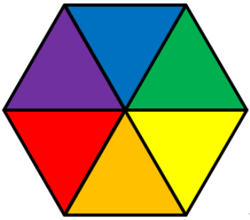

# 문제 소개

문제 사이트 하이퍼링크

아래와 같은 육각 색상환을 생각해 보자.

먼저 빨강, 노랑, 파랑을 배치하고, 사이사이에는 두 색상의 물감을 섞어서 만들 수 있는 색을 넣은 것이다.

아래 그림에서 좌측 하단부터 시작해서 반시계방향으로 빨강색(red), 오렌지색(orange), 노란색(yellow), 초록색(green), 파랑색(blue), 보라색(purple)이 들어 있다.



위의 색상환에 있는 색 두 개가 주어질 때, 두 색이

- 서로 같은 색인지
- 색상환에서 인접한 (한 변을 공유하고 있는) 색인지
- 색상환에서 서로 반대에 있는 (마주보고 있는) 색인지

를 판별하는 프로그램을 작성하라.

**[입력]**

첫 번째 줄에 테스트 케이스의 수 T가 주어진다.

각 테스트 케이스는 한 개의 줄로 이루어진다.

각 줄에는 두 개의 색을 나타내는 두 문자열 S와 T가 공백 하나를 사이로 두고 주어진다. S와 T는 각각 red, orange, yellow, green, blue, purple 중 하나이다.

**[출력]**

각 테스트 케이스마다, 하나의 줄에 주어진 두 색이

- 서로 같은 색이라면 ‘E’
- 색상환에서 인접한 (한 변을 공유하고 있는) 색이라면 ‘A’
- 색상환에서 서로 반대에 있는 (마주보고 있는) 색이라면 ‘C’
- 셋 다 아니라면 ‘X’

를 따옴표를 제외하고 출력한다.

```cpp
입력
4
red red
red purple
red green
red yellow

출력
E
A
C
X
```

---

# 풀이 과정

- 같은 색, 인접한 색, 마주보는 색만 구분하면 되니까 하드코딩 말고 다른 방법이 있을지 고민하다가 `map<string, char>`를 썼다.
- 두 색의 첫 글자를 붙인 키에 인접(A)과 반대(C) 관계를 넣어두고, 같은 색이면 E, 키가 없으면 순서를 뒤집어서 한 번 더 찾고, 그래도 없으면 X를 출력했다.
- 15분에 통과했다.

```cpp
#include<iostream>
#include <map>

using namespace std;

/*
육각 색상환
- Red, Yellow, Blue 하고 그 사이에 섞어서 만듬.

위의 색상환에 있는 색 두 개가 주어질 때, 두 색이
- 서로 같은 색인지 = E
- 색상환에서 인접한 (한 변을 공유하고 있는) 색인지 = A
- 색상환에서 서로 반대에 있는 (마주보고 있는) 색인지 = C
- 셋 다 아니라면 X
를 판별하는 프로그램을 작성

맨 처음 하드 코딩하는 거 말고 다른 형식이 있나?
- map <string, char> 

15분 클리어
*/
int main(int argc, char** argv)
{
	int test_case;
	int T;

	cin >> T;

	map<string, char> color;

	color["rp"] = 'A';
	color["rg"] = 'C';
	color["ro"] = 'A';
	color["py"] = 'C';
	color["pb"] = 'A';
	color["bg"] = 'A';
	color["bo"] = 'C';
	color["gy"] = 'A';
	color["yo"] = 'A';
	for (test_case = 1; test_case <= T; ++test_case) {
		string c1, c2;

		cin >> c1 >> c2;

		if (c1 == c2) {
			cout << "E" << endl;
		}
		else {
			string c, rc;

			c += c1[0];
			c += c2[0];
			rc += c2[0];
			rc += c1[0];
			if (color[c]) {
				cout << color[c] << endl;
			}
			else if (color[rc]) {
				cout << color[rc] << endl;
			}
			else {
				cout << "X" << endl;
			}
		}
	}
	return 0;//정상종료시 반드시 0을 리턴해야합니다.
}
```

---

# 결과 & 근거

**성공 (15분)**

- 6색의 첫 글자(r, o, y, g, b, p)가 모두 달라서 첫 글자 두 개로 색 조합을 구분할 수 있다.
- 색상환처럼 원형으로 놓인 것은 색을 위치(0~5)로 두고 (p1 - p2 + 6) % 6로 거리를 구하면, 0은 같은 색, 1은 인접, 3은 반대, 나머지는 X로 조합 없이 판별된다.
- map에서 존재 여부를 볼 때 operator[]는 없는 키를 삽입하므로 count나 find가 안전하다.

```cpp
#include<iostream>
#include <string>

using namespace std;

int main(int argc, char** argv)
{
	ios::sync_with_stdio(false);
	cin.tie(nullptr);

	// 색상환을 반시계 순서 그대로 배열에 둔다 → 색 = 원 위의 위치(0~5)
	string ring[6] = { "red", "orange", "yellow", "green", "blue", "purple" };

	int test_case;
	int T;
	cin >> T;

	for (test_case = 1; test_case <= T; ++test_case) {
		string c1, c2;
		cin >> c1 >> c2;

		// 두 색의 위치 찾기
		int p1 = 0, p2 = 0;
		for (int i = 0; i < 6; i++) {
			if (ring[i] == c1) p1 = i;
			if (ring[i] == c2) p2 = i;
		}

		// 원 위의 거리: 시계/반시계 중 짧은 쪽 (0 ~ 3)
		int d = (p1 - p2 + 6) % 6;   // 음수 방지 (음수 나머지 패턴)
		if (d > 3) d = 6 - d;

		if (d == 0) cout << "E" << '\n';        // 같은 색
		else if (d == 1) cout << "A" << '\n';   // 바로 옆
		else if (d == 3) cout << "C" << '\n';   // 정반대 (6칸의 절반)
		else cout << "X" << '\n';               // 두 칸 떨어짐
	}
	return 0;//정상종료시 반드시 0을 리턴해야합니다.
}
```

> 
> 
> 
> ***한 줄 요약***
> 
> **구현 문제.** 
> 
> 색상환의 색을 원 위의 위치로 두고, 두 위치의 원형 거리(짧은 쪽)를 구해 0이면 E, 1이면 A, 3이면 C, 그 외는 X로 판별한다. 음수 없이 원형 거리를 구하는 (p1 - p2 + 6) % 6이 핵심.
> 

### 알고리즘 분류

- 구현
- 문자열