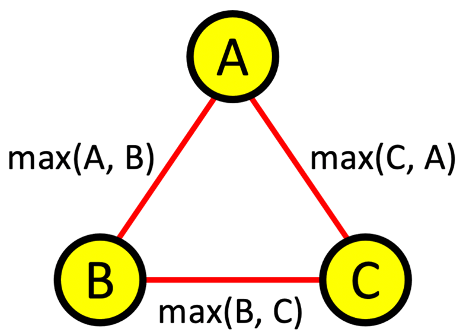

# SWEA 25695, 세 정수 (성공)

# 문제 소개

[문제 사이트 하이퍼링크](https://swexpertacademy.com/main/code/problem/problemDetail.do?contestProbId=AZqV4CD6bJLHBIPC&categoryId=AZqV4CD6bJLHBIPC&categoryType=CODE&problemTitle=25695&orderBy=FIRST_REG_DATETIME&selectCodeLang=ALL&select-1=&pageSize=10&pageIndex=1)



세 자연수 X, Y, Z가 있다.

X = max(A, B), Y = max(B, C), Z = max(C, A)를 만족시키는 세 정수 A, B, C가 존재하는지 판단하고, 존재한다면 그 중 한 순서쌍을 출력하는 프로그램을 작성하라.

**[입력]**

첫 번째 줄에 테스트 케이스의 수 T가 주어진다.

각 테스트 케이스는 한 개의 줄로 이루어지며, 각 줄에는 세 개의 정수 X, Y, Z가 주어진다. 각 정수는 1 이상 10^9 이하이다.

**[출력]**

각 테스트 케이스마다,

-  조건을 만족하는 A, B, C가 존재하지 않는다면 “-1 -1 -1”을 출력한다.

-  조건을 만족하는 A, B, C가 존재한다면 그 중 한 가지를 공백 하나씩을 사이로 두고 출력한다.

---

# 풀이 과정

- 간단한 문제라고 봤다.
    - 중복 조합을 사용해서 X, Y, Z가 성립하는지 확인하는 문제로 접근했다.
    - `arr`에 X, Y, Z를 넣고 세 자리를 재귀로 채워가며 `max(combi[0], combi[1]) == x` 꼴의 조건 세 개를 전부 만족하는 조합을 찾으면 출력하고 종료하는 구조로 짰다.
- A, B, C가 10^9까지 가능하였기에, 모든 경우의 수를 카운팅 하라 라는 느낌의 문제였으면 확실히 어려워졌을 거라고 생각했다.
- 그리고 X, Y, Z가 모두 같은 경우는 특수 케이스라고 판단해서 재귀 전에 따로 분기를 빼뒀다.

```cpp
int x, y, z;
vector<int> arr, combi;
bool flag = false;

void three_int () {
    if (flag) return;
    if (combi.size() == 3) {
        if (x == max(combi[0], combi[1]) && y == max(combi[1], combi[2]) && z == max(combi[2], combi[0])) {
            flag = true;
            cout << combi[0] << " " << combi[1] << " " << combi[2] << endl;
            return;
        }
        return;
    }
    for (int i = 0; i < 3; ++i) {
        combi.push_back(arr[i]);
        three_int ();
        combi.pop_back();
    }
}

int main(int argc, char** argv) {
    cin >> T;
    for (test_case = 1; test_case <= T; ++test_case) {
        flag = false; arr.assign(3, 0); combi.clear();
        cin >> x >> y >> z;
        arr[0] = x, arr[1] = y, arr[2] = z;

        if (x == y && y == z) { cout << x << " " << y << " " << z << endl; continue; }

        three_int();
        if (!flag) cout << "-1 -1 -1" << endl;
    }
}
```

---

# 결과 & 근거

- **23분 제출 — 오답 (95,184개 중 94,232개 통과)** → **26분 재제출 — 성공**
- 알고리즘은 처음부터 맞았다. `X, Y, Z`를 1~12 전 범위로 돌려 전수탐색과 대조했을 때 존재 판정 불일치 0건
    - 틀린 원인은 **스스로 추가한 `x==y==z` 특수 분기**다. 이 분기는 애초에 필요 없었다 — 일반 로직(중복순열 27가지)이 `(v,v,v)`를 이미 포함하기 때문. 불필요한 분기 안에서 예제의 `1 1 1`을 변수 대신 리터럴로 출력해 952개가 틀렸다
    - 내가 "중복 조합"이라고 부른 것은 실제로는 중복순열(3³ = 27)이었다. A, B, C의 역할이 서로 다르므로 순열이어야 하며, 중복조합 10가지로 줄이면 1,728 조합 중 66개를 놓친다

```cpp
#include <iostream>
#include <algorithm>
using namespace std;

int main() {
    ios::sync_with_stdio(false);
    cin.tie(nullptr);

    int T;
    cin >> T;
    for (int tc = 1; tc <= T; ++tc) {
        int x, y, z;
        cin >> x >> y >> z;

        // A 는 X, Z 식에만 등장 -> A <= min(X,Z)
        // B 는 X, Y 식에만 등장 -> B <= min(X,Y)
        // C 는 Y, Z 식에만 등장 -> C <= min(Y,Z)
        // max 는 단조증가이므로 상한을 그대로 꽂은 것이 최선의 후보다
        int a = min(x, z);
        int b = min(x, y);
        int c = min(y, z);

        // 상한으로도 안 되면 더 작은 값으로는 절대 안 된다
        bool ok = (max(a, b) == x) && (max(b, c) == y) && (max(c, a) == z);

        cout << '#' << tc << ' ';
        if (ok) cout << a << ' ' << b << ' ' << c << '\n';
        else    cout << "-1 -1 -1" << '\n';
    }
    return 0;
}
```

> 
> 
> 
> ***한 줄 요약***
> 
> **중복 순열을 통한 브루트 포스 + 가능 케이스 출력 문제.**
> 
> 알고리즘은 맞았는데, 일반 로직이 이미 처리하는 케이스를 "특수 케이스"로 착각해 분기를 추가하고 거기서 예제 출력값을 하드코딩해 952개를 틀렸다. 각 변수가 어느 식에 등장하는지 세어보면 `A ≤ min(X,Z)` 같은 상한이 바로 나오고, `max`가 단조증가라는 성질 때문에 상한을 한 번 꽂아 검증하는 O(1) 풀이로 열거 자체를 없앨 수 있었다. 분기를 추가하기 전에 "일반 로직이 이 입력을 못 다루나?"를 한 줄 확인하는 습관이 없었던 게 이번의 유일한 실패 원인이다.
> 

### 알고리즘 분류

- 브루트포스 / 완전탐색
- 중복순열 (후보 집합을 입력값으로 한정하는 기법)
- 수학 / 그리디 (단조성을 이용한 상한 구성 + 검증)
- 구현