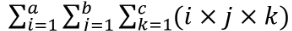

# 문제 소개

문제 사이트 하이퍼링크

세 정수 a,b,c 가 주어졌을 때, 다음 식을 998244353 으로 나눈 나머지를 출력하라.



**[입력]**

첫 번째 줄에 테스트 케이스의 수 TC가 주어진다.

이후 TC개의 테스트 케이스가 새 줄로 구분되어 주어진다.

각 테스트 케이스는 다음과 같이 구성되었다.

- 첫 번째 줄에 세 정수 a, b, c 가 주어진다. (1 ≤ a, b, c ≤ 109)

**[출력]**

각 테스트 케이스 마다 한 줄씩, 정답을 출력하라.

```cpp
입력
3
1 1 1
1 2 3
192279221 156648747 154396385

출력
1
18
152138957
```

---

# 풀이 과정

- 근처 접근도 못했어
- 1/18 쯤이었나
- 처음엔 식을 a! * b! * c!로 읽었다가, 예제 1 2 3 → 18을 대입해 보고 1부터 a까지의 합, b까지의 합, c까지의 합을 곱하는 식이라는 걸 찾았다.
- a(a+1)/2 * b(b+1)/2 * c(c+1)/2를 한 줄로 곱하고 마지막에 나머지를 구했는데, 큰 예제에서 값이 맞지 않아 빠르게 포기했다.

```cpp
#include<iostream>
 
using namespace std;
 
/*
 
곱의 합
 
a,b,c가 주어졌을때, a!*b!*c! % 998244353을 구하라.
1 ≤ a, b, c ≤ 10^9
 
 
1 1 1
-> 1 * 1 * 1 = 1
 
 
1 2 3
-> (1) * (3) (1+2+3) = 18
 
192279221, 156648747, 154396385
= (1~192279221 합) * (1~156648747합) * (1~154396385합) %  998244353 
 
8593621931
152138957
-> 이걸 어떻게 구하는 걸까? 이전에 풀었던 문제랑 비슷한데,
 
-> 192279221 * 192279222 /2 * 156648747 * 156648748 /2 * 154396385 * 154 396 386 / 2 % 9 982 443 353 으로 구할 수 있음
 
시그마 식 설명이 뭔데...
*/
 
int main(int argc, char** argv)
{
    int test_case;
    int T;
 
    cin >> T;
 
    for (test_case = 1; test_case <= T; ++test_case)
    {
        long long a, b, c;
        cin >> a >> b >> c;
 
        //
 
        cout << a * (a + 1) / 2 * b * (b + 1) / 2 * c * (c+1) / 2 % 9982443353 << endl;
 
    }
    return 0;//정상종료시 반드시 0을 리턴해야합니다.
}
```

---

# 결과 & 근거

**실패 (빠른 포기, TC 약 1/18)**

- MOD를 9982443353으로 잘못 적었고(정답 998244353), 세 합을 한 줄에 다 곱해서 a = b = c = 1825부터 long long을 넘었다.
- 1~x의 합은 x(x+1)/2를 먼저 정확히 구한 뒤 % MOD 한다. x ≤ 10^9라 x(x+1)은 약 10^18로 long long 안에 들어가고, /2는 % 전에 해야 깨지지 않는다.
- 곱셈은 중간에 나머지를 취해도 되므로, 세 합을 곱할 때마다 % MOD 한다.

```cpp
#include<iostream>

using namespace std;

const long long MOD = 998244353;

// 1 + 2 + ... + x 를 MOD로 나눈 나머지
// x ≤ 10^9 → x * (x + 1) ≤ 약 10^18 < long long 최대(약 9.2 * 10^18)라서 한 번은 그대로 곱해도 된다
// 나누기 2는 % 하기 "전에" 한다 (나머지를 먼저 취하면 나눗셈이 깨진다)
long long sum(long long x) {
	return x * (x + 1) / 2 % MOD;
}

int main(int argc, char** argv)
{
	ios::sync_with_stdio(false);
	cin.tie(nullptr);

	int test_case;
	int T;
	cin >> T;

	for (test_case = 1; test_case <= T; ++test_case)
	{
		long long a, b, c;
		cin >> a >> b >> c;

		// Σi Σj Σk (i * j * k) = (Σi) * (Σj) * (Σk)  → 세 합을 따로 구해서 곱한다
		// 곱할 때마다 % MOD → 두 수가 모두 MOD 미만(약 10억)이라 곱은 약 10^18, long long 안에 들어간다
		long long sa = sum(a), sb = sum(b), sc = sum(c);
		long long answer = sa * sb % MOD * sc % MOD;

		cout << answer << '\n';
	}
	return 0;//정상종료시 반드시 0을 리턴해야합니다.
}
```

> 
> 
> 
> ***한 줄 요약***
> 
> **모듈러 수학 문제.** 
> 
> 세 겹의 시그마는 (1~a의 합) × (1~b의 합) × (1~c의 합)으로 쪼개진다. 각 합을 x(x+1)/2 % MOD로 줄이고 곱할 때마다 % MOD 해서 오버플로를 막는 게 핵심.
> 

### 알고리즘 분류

- 수학
- 모듈러 연산