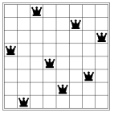

# SWEA 2806, N-Queen (성공)

# 문제 소개

[문제 사이트 하이퍼링크](https://swexpertacademy.com/main/code/problem/problemDetail.do?problemLevel=2&problemLevel=3&contestProbId=AV7GKs06AU0DFAXB&categoryId=AV7GKs06AU0DFAXB&categoryType=CODE&problemTitle=&orderBy=SUBMIT_COUNT&selectCodeLang=ALL&select-1=3&pageSize=10&pageIndex=4)

8*8 체스보드에 8개의 퀸을 서로 공격하지 못하게 놓는 문제는 잘 알려져 있는 문제이다.

퀸은 같은 행, 열, 또는 대각선 위에 있는 말을 공격할 수 있다. 이 문제의 한가지 정답은 아래 그림과 같다.



이 문제의 조금 더 일반화된 문제는 Franz Nauck이 1850년에 제기했다.

N*N 보드에 N개의 퀸을 서로 다른 두 퀸이 공격하지 못하게 놓는 경우의 수는 몇가지가 있을까?

N이 주어졌을 때, 퀸을 놓는 방법의 수를 구하는 프로그램을 작성하시오.

**[입력]**

첫 번째 줄에 테스트 케이스의 수 T가 주어진다.

각 테스트 케이스의 첫 번째 줄에는 하나의 자연수 N(1 ≤ N ≤ 10)이 주어진다.

**[출력]**

각 테스트 케이스마다 ‘#x ’(x는 테스트케이스 번호를 의미하며 1부터 시작한다)를 출력하고, 퀸 N개를 서로 공격할 수 없게 놓는 경우의 수를 출력한다.

---

# 풀이 과정

- 행은 재귀로 하나씩 내려가고, 열은 중복되지 않게 고르는 방식으로 접근했다.
- N개를 다 놓은 뒤에 각 퀸에서 8방향으로 공격 가능한지 검사했다.
- 조합 최적화와 공격 검사에서 시간이 많이 걸렸고, 처음엔 3/10에서 TLE가 났다 (약 40분).

```cpp
#include<iostream>
#include <vector>
using namespace std;

/*

8*8 보드에서 8개 퀸이 서로 공격하지 못하게 하는 문제.
그럼 N*N 보드에 N개의 퀸을 서로 다른 두 퀸이 공격하지 못하게 놓는 경우의 수는 몇가지?

정말 간단하게 생각나는 거
- 행은 for문으로 증가 + 열은 조합으로 접근 + 8방향 검사.

N은 최대 10.
지금 8x8 기준
vector<int> queen;
void combi (int start, int col, ){}

1 기준 정확히 1

2 기준 2x2 보드에 2개의 퀸이 서로 공격하지 못하게 놓는 경우의 수
-> 0

3 기준

*/

int n, answer = 0;
vector<pair<int, int>> queen;
int board[11][11];

vector<int> col_v;

void combi(int start, int row) {
	if (queen.size() == n) {
		// 검사
		/*for (int i = 0; i < queen.size(); i++) {
			cout << queen[i].first << " " << queen[i].second << '\t';
		} cout << endl;*/

		int dx[8] = { 1, -1, 0, 0, 1, 1, -1, -1 }, dy[8] = { 0, 0, 1, -1, 1, -1, 1, -1 };
		bool chk = false;
		for (pair<int, int> q : queen) {
			for (int i = 0; i < 8; i++) {
				int j = 1;
				while (true) {
					int nx = q.first + dx[i] * j, ny = q.second + dy[i] * j;
					if (nx < 0 || ny < 0 || nx >= n || ny >= n) {
						break;
					}
					if (board[nx][ny] == 1) {
						chk = true;
						break;
					}
					j++;
				}
				if (chk) break;
			}
			if (chk) break;
		}

		if (!chk) {
			// 서로 공격 불가능
			answer++;
		}
	}
	else {
		// 중복 허용 조합을 해야 하나?

		for (int i = 0; i < n; i++) {

			if (col_v[i] == 0) {
				queen.push_back({ row, i });
				col_v[i] = 1;
				board[row][i] = 1;

				combi(i + 1, row + 1);

				queen.pop_back();
				col_v[i] = 0;
				board[row][i] = 0;
			}

		}
	}
}
int main(int argc, char** argv)
{
	int test_case;
	int T;

	cin >> T;

	for (test_case = 1; test_case <= T; ++test_case) {

		cin >> n;
		queen.clear();
		col_v.assign(n, 0);

		combi(0, 0);

		cout << "#" << test_case << " " << answer << endl;
		answer = 0;
	}

	/*
	3/10, TLE 발생.
	*/

	return 0;//정상종료시 반드시 0을 리턴해야합니다.
}
```

---

# 결과 & 근거

**성공 (약 40분)**

- 다 놓은 뒤에 검사하면 열 순열 10! 개를 전부 만들어서 느리다 (N=10 한 케이스 0.45초).
- 놓기 전에 열과 두 대각선(`r + c`, `r - c`가 같으면 같은 대각선)을 배열로 O(1) 검사하면 안 되는 가지를 바로 자를 수 있다.

```cpp
// 더 깔끔한 코드
#include <iostream>
#include <vector>

using namespace std;

int n, answer = 0;
vector<int> col_v;   // col_v[c] = c열에 퀸이 있나
vector<int> diag1;   // diag1[r + c]        = ↙ 방향 대각선 사용 중 (r + c가 같으면 같은 대각선)
vector<int> diag2;   // diag2[r - c + n - 1] = ↘ 방향 대각선 사용 중 (r - c가 같으면 같은 대각선, 음수 방지로 +n-1)

// row행에 퀸을 놓을 차례
void place(int row) {
	if (row == n) { answer++; return; }   // n행 모두 놓음 = 서로 공격 못 하는 배치 1개

	for (int c = 0; c < n; c++) {
		// 놓기 "전에" 검사 → 안 되면 이 아래는 아예 탐색하지 않음 (가지치기)
		if (col_v[c] || diag1[row + c] || diag2[row - c + n - 1]) continue;

		col_v[c] = diag1[row + c] = diag2[row - c + n - 1] = 1;   // 마킹 (재귀 전)
		place(row + 1);
		col_v[c] = diag1[row + c] = diag2[row - c + n - 1] = 0;   // 리셋 (재귀 후)
	}
}

int main(int argc, char** argv)
{
	int test_case;
	int T;
	cin >> T;

	for (test_case = 1; test_case <= T; ++test_case) {
		cin >> n;
		answer = 0;                      // 전역 → 테스트 케이스 시작에서 초기화
		col_v.assign(n, 0);
		diag1.assign(2 * n, 0);
		diag2.assign(2 * n, 0);

		place(0);
		cout << "#" << test_case << " " << answer << '\n';
	}
	return 0;//정상종료시 반드시 0을 리턴해야합니다.
}

```

> 
> 
> 
> ***한 줄 요약***
> 
> **백트래킹 문제.** 
> 
> 행마다 퀸을 하나씩 놓되 열과 두 대각선(r+c, r−c) 사용 여부를 배열로 기록해 놓기 전에 검사하고, 끝까지 놓으면 개수를 센다. 다 놓은 뒤가 아니라 놓을 때 가지치기하는 게 핵심.
> 

### 알고리즘 분류

- 백트래킹
- 브루트포스