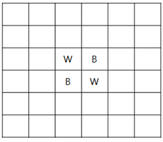

# SWEA 4615, 재미있는 오셀로 게임 (성공)

# 문제 소개

[문제 하이퍼링크](https://swexpertacademy.com/main/code/problem/problemDetail.do)

오셀로라는 게임은 흑돌과 백돌을 가진 사람이 번갈아가며 보드에 돌을 놓아서 최종적으로 보드에 자신의 돌이 많은 사람이 이기는 게임이다.

보드는 4x4, 6x6, 8x8(가로, 세로 길이) 크기를 사용한다. 6x6 보드에서 게임을 할 때, 처음에 플레이어는 다음과 같이 돌을 놓고 시작한다(B : 흑돌, W : 백돌).

4x4, 8x8 보드에서도 동일하게 정가운데에 아래와 같이 배치하고 시작한다.



그리고 흑, 백이 번갈아가며 돌을 놓는다.

처음엔 흑부터 시작하는데 이 때 흑이 돌을 놓을 수 있는 곳은 다음과 같이 4군데이다.


플레이어는 빈공간에 돌을 놓을 수 있다.

단, 자신이 놓을 돌과 자신의 돌 사이에 상대편의 돌이 있을 경우에만 그 곳에 돌을 놓을 수 있고, 그 때의 상대편의 돌은 자신의 돌로 만들 수 있다.

(여기에서 "사이"란 가로/세로/대각선을 의미한다.)

(2, 3) 위치에 흑돌을 놓은 후의 보드는 다음과 같다.


이런 식으로 번갈아가며 흑, 백 플레이어가 돌을 놓는다.

만약 돌을 놓을 곳이 없다면 상대편 플레이어가 다시 돌을 놓는다.

보드에 빈 곳이 없거나 양 플레이어 모두 돌을 놓을 곳이 없으면 게임이 끝나고 그 때 보드에 있는 돌의 개수가 많은 플레이어가 승리하게 된다.

**[입력]**

첫 번째 줄에 테스트 케이스의 수 T가 주어진다.

각 테스트 케이스의 첫 번째 줄에는 보드의 한 변의 길이 N과 플레이어가 돌을 놓는 횟수 M이 주어진다. N은 4, 6, 8 중 하나이다.

그 다음 M줄에는 돌을 놓을 위치와 돌의 색이 주어진다.

돌의 색이 1이면 흑돌, 2이면 백돌이다.

만약 3 2 1이 입력된다면 (3, 2) 위치에 흑돌을 놓는 것을 의미한다.

돌을 놓을 수 없는 곳은 입력으로 주어지지 않는다.

**[출력]**

각 테스트 케이스마다 게임이 끝난 후 보드 위의 흑돌, 백돌의 개수를 출력한다.

흑돌이 30개, 백돌이 34인 경우 30 34를 출력한다.

```cpp
1 // T
4 12 // N, M
1 2 1 // (1, 2)에 흑돌 놓기
1 1 2 //( 1, 1)에 백돌 놓기
4 3 1 
4 4 2
2 1 1
4 2 2
3 4 1
1 3 2
2 4 1
1 4 2
4 1 2
3 1 2

출력
#1 0 16
```

---

# 풀이 과정

- 오셀로 규칙을 IDE에서 직접 게임해보며 이해하느라 시간이 오래 걸렸고, 8방향 탐색과 구현은 빨랐다.
- 돌을 놓은 뒤 8방향으로 나가면서 상대 돌을 임시로 모으고, 내 돌을 만나면 확정, 판 밖이나 빈칸을 만나면 버리는 방식으로 짰다.
- 4×4 예제에서 첫 줄이 잘못 뒤집히는 오류가 있었는데, 판 밖이나 빈칸을 만나면 모은 걸 전부 버리도록 해서 해결했다 (45분).

```cpp
#include<iostream>
#include <vector>

using namespace std;

int main(int argc, char** argv)
{
	int test_case;
	int T;

	cin >> T;
	for (test_case = 1; test_case <= T; ++test_case) {
		int n, m;
		cin >> n >> m;

		// 1번 인덱스부터 쓰려고 (n+1) x (n+1). 0 = 빈칸, 1 = 흑, 2 = 백
		vector<vector<int>> arr(n + 1, vector<int>(n + 1));

		// 가운데 초기 배치: 백은 좌상-우하 대각선, 흑은 반대 대각선
		arr[n / 2][n / 2] = 2;
		arr[n / 2 + 1][n / 2 + 1] = 2;
		arr[n / 2][n / 2 + 1] = 1;
		arr[n / 2 + 1][n / 2] = 1;

		// 상, 하, 좌, 우, 좌상, 좌하, 우상, 우하
		int dx[8] = { -1, 1, 0, 0, -1, 1, -1, 1 };
		int dy[8] = { 0, 0, -1, 1, -1, -1, 1, 1 };

		for (int i = 0; i < m; i++) {
			int x, y, stone;
			cin >> x >> y >> stone;

			// 시작 배치와 규칙이 행/열 대칭이라, [y][x]로 저장해도 최종 개수는 같다
			arr[y][x] = stone;

			vector<pair<int, int>> v;      // 이번 수로 확정된 "뒤집을 돌" 모음
			vector<pair<int, int>> temp;   // 한 방향에서 지나온 상대 돌 (후보)

			for (int d = 0; d < 8; d++) {  // 바깥 i와 이름이 겹치지 않게 d
				temp.clear();
				int j = 1;
				while (true) {
					int nx = x + dx[d] * j, ny = y + dy[d] * j;

					// 판 밖 → 이 방향은 내 돌로 안 막힘 → 후보 버리기
					if (ny <= 0 || nx <= 0 || ny > n || nx > n) { temp.clear(); break; }

					// 빈칸 → 사이가 끊김 → 후보 버리기
					if (arr[ny][nx] == 0) { temp.clear(); break; }

					// 내 돌을 만남 → 지나온 상대 돌들이 전부 뒤집힐 대상으로 확정
					if (arr[ny][nx] == stone) {
						for (pair<int, int> p : temp) v.push_back(p);
						break;
					}

					// 상대 돌 → 일단 후보에 담고 한 칸 더
					temp.push_back({ nx, ny });
					j++;
				}
			}

			// 8방향 확정분을 한 번에 뒤집기
			for (pair<int, int> p : v) arr[p.second][p.first] = stone;
		}

		int black = 0, white = 0;
		for (int i = 1; i <= n; i++) {
			for (int j = 1; j <= n; j++) {
				if (arr[i][j] == 1) black++;
				else if (arr[i][j] == 2) white++;
			}
		}

		cout << "#" << test_case << " " << black << " " << white << '\n';
	}
	return 0;//정상종료시 반드시 0을 리턴해야합니다.
}

```

---

# 결과 & 근거

**성공 (45분)**

- 8방향마다 상대 돌을 후보로 모으다가 내 돌을 만나면 확정, 판 밖이나 빈칸이면 버리는 구조가 오셀로 뒤집기의 정석이다.
- 시작 배치와 규칙이 행/열 대칭이라 `(x, y)` 해석 순서와 상관없이 개수는 같다.
- 바깥 루프와 방향 루프가 같은 변수명 `i`를 쓰면 헷갈리니까 방향은 `d`로 쓴다.

```cpp
/// 더 깔끔한 코드
#include<iostream>
#include <vector>

using namespace std;

int main(int argc, char** argv)
{
	int test_case;
	int T;

	cin >> T;
	for (test_case = 1; test_case <= T; ++test_case) {
		int n, m;
		cin >> n >> m;

		// 1번 인덱스부터 쓰려고 (n+1) x (n+1). 0 = 빈칸, 1 = 흑, 2 = 백
		vector<vector<int>> arr(n + 1, vector<int>(n + 1));

		// 가운데 초기 배치: 백은 좌상-우하 대각선, 흑은 반대 대각선
		arr[n / 2][n / 2] = 2;
		arr[n / 2 + 1][n / 2 + 1] = 2;
		arr[n / 2][n / 2 + 1] = 1;
		arr[n / 2 + 1][n / 2] = 1;

		// 상, 하, 좌, 우, 좌상, 좌하, 우상, 우하
		int dx[8] = { -1, 1, 0, 0, -1, 1, -1, 1 };
		int dy[8] = { 0, 0, -1, 1, -1, -1, 1, 1 };

		for (int i = 0; i < m; i++) {
			int x, y, stone;
			cin >> x >> y >> stone;

			// 시작 배치와 규칙이 행/열 대칭이라, [y][x]로 저장해도 최종 개수는 같다
			arr[y][x] = stone;

			vector<pair<int, int>> v;      // 이번 수로 확정된 "뒤집을 돌" 모음
			vector<pair<int, int>> temp;   // 한 방향에서 지나온 상대 돌 (후보)

			for (int d = 0; d < 8; d++) {  // 바깥 i와 이름이 겹치지 않게 d
				temp.clear();
				int j = 1;
				while (true) {
					int nx = x + dx[d] * j, ny = y + dy[d] * j;

					// 판 밖 → 이 방향은 내 돌로 안 막힘 → 후보 버리기
					if (ny <= 0 || nx <= 0 || ny > n || nx > n) { temp.clear(); break; }

					// 빈칸 → 사이가 끊김 → 후보 버리기
					if (arr[ny][nx] == 0) { temp.clear(); break; }

					// 내 돌을 만남 → 지나온 상대 돌들이 전부 뒤집힐 대상으로 확정
					if (arr[ny][nx] == stone) {
						for (pair<int, int> p : temp) v.push_back(p);
						break;
					}

					// 상대 돌 → 일단 후보에 담고 한 칸 더
					temp.push_back({ nx, ny });
					j++;
				}
			}

			// 8방향 확정분을 한 번에 뒤집기
			for (pair<int, int> p : v) arr[p.second][p.first] = stone;
		}

		int black = 0, white = 0;
		for (int i = 1; i <= n; i++) {
			for (int j = 1; j <= n; j++) {
				if (arr[i][j] == 1) black++;
				else if (arr[i][j] == 2) white++;
			}
		}

		cout << "#" << test_case << " " << black << " " << white << '\n';
	}
	return 0;//정상종료시 반드시 0을 리턴해야합니다.
}

```

> 
> 
> 
> ***한 줄 요약***
> 
> **8방향 격자 시뮬레이션 문제.** 
> 
> 돌을 놓을 때마다 8방향으로 상대 돌을 후보로 모으다가 내 돌을 만나면 확정, 판 밖이나 빈칸을 만나면 버린 뒤 한 번에 뒤집는다. "모았다가 확정 또는 폐기" 구조가 핵심.
> 

### 알고리즘 분류

- 구현
- 시뮬레이션
- 격자 (8방향 탐색)