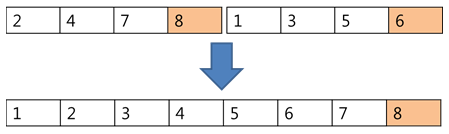

# SWEA 5204, 병합 정렬 (실패)

# 문제 소개

[문제 사이트 하이퍼링크](https://swexpertacademy.com/main/code/problem/problemDetail.do?problemLevel=3&contestProbId=AWT-Pu3acjYDFAVT&categoryId=AWT-Pu3acjYDFAVT&categoryType=CODE&problemTitle=&orderBy=SUBMIT_COUNT&selectCodeLang=ALL&select-1=3&pageSize=10&pageIndex=5)

알고리즘 교수님은 학생들에게 병합 정렬을 이용해 오름차순으로 정렬하는 과제를 내려고 한다.

정렬 된 결과만으로는 실제로 병합 정렬을 적용했는지 알 수 없기 때문에 다음과 같은 제약을 주었다.

N개의 정렬 대상을 가진 리스트 L을 분할할 때 L[0:N//2], L[N//2:N]으로 분할 한다.

병합 과정에서 다음처럼 왼쪽 마지막 원소가 오른쪽 마지막 원소보다 큰 경우의 수를 출력한다.



정렬이 끝난 리스트 L에서 L[N//2] 원소를 출력한다.

알고리즘 교수님의 조건에 따라 병합 정렬을 수행하는 프로그램을 만드시오.

**[입력]**

첫 줄에 테스트케이스의 수 T가 주어진다. 1<=T<=50

다음 줄부터 테스트 케이스의 별로 정수의 개수 N이 주어지고, 다음 줄에 N개의 정수 a(i) 가 주어진다.

- 5<=N<=1,000,000,
- 0 <= a(i)<= 1,000,000

**[출력]**

각 줄마다 "#T" (T는 테스트 케이스 번호)를 출력한 뒤,  N//2 번째 원소와 오른쪽 원소가 먼저 복사되는 경우의 수를 출력한다.

```cpp
입력
2
5
2 2 1 1 3
10
7 5 4 1 2 10 3 6 9 8	 

출력
#1 2 0
#2 6 6
```

---

# 풀이 과정

- 아예 풀지도 못했다 😓

---

# 결과 & 근거

- 지문대로 `L[0:N//2]`, `L[N//2:N]`으로 나눠 재귀 정렬하고, 병합 직전에 왼쪽 마지막 원소가 오른쪽 마지막 원소보다 크면 센다.
- N ≤ 10⁶이라 배열을 전역에 두고 임시 배열 하나를 재사용하며, 입출력 가속을 해야 한다.

```cpp
#include <iostream>
#include <vector>

using namespace std;

vector<int> arr, tmp;   // 큰 배열은 전역 (VS 스택 1MB 함정 회피), tmp는 병합용 임시 배열
long long cnt;          // "왼쪽 마지막 > 오른쪽 마지막"인 병합 횟수

// [lo, hi) 구간을 정렬
void merge_sort(int lo, int hi) {
	if (hi - lo <= 1) return;            // 원소 1개 이하는 이미 정렬됨

	int mid = lo + (hi - lo) / 2;        // 지문: L[0:N//2], L[N//2:N]
	merge_sort(lo, mid);
	merge_sort(mid, hi);

	// 병합 "직전"에 왼쪽 마지막 원소 > 오른쪽 마지막 원소인지 확인
	if (arr[mid - 1] > arr[hi - 1]) cnt++;

	// 두 정렬된 구간을 tmp에 합치기
	int i = lo, j = mid, k = lo;
	while (i < mid && j < hi) {
		if (arr[i] <= arr[j]) tmp[k++] = arr[i++];
		else tmp[k++] = arr[j++];
	}
	while (i < mid) tmp[k++] = arr[i++];
	while (j < hi) tmp[k++] = arr[j++];
	for (int t = lo; t < hi; t++) arr[t] = tmp[t];   // 결과를 원래 배열로
}

int main(int argc, char** argv)
{
	// N이 최대 100만 → 입력 가속
	ios::sync_with_stdio(false);
	cin.tie(nullptr);

	int test_case;
	int T;
	cin >> T;

	for (test_case = 1; test_case <= T; ++test_case) {
		int n;
		cin >> n;
		arr.assign(n, 0);
		tmp.assign(n, 0);
		for (int i = 0; i < n; i++) cin >> arr[i];

		cnt = 0;   // 전역 → 테스트 케이스 시작에서 초기화
		merge_sort(0, n);

		cout << "#" << test_case << " " << arr[n / 2] << " " << cnt << '\n';
	}
	return 0;//정상종료시 반드시 0을 리턴해야합니다.
}

```

> 
> 
> 
> ***한 줄 요약***
> 
> **분할 정복(병합 정렬) 구현 문제.** 
> 
> 지문대로 N//2 기준으로 나눠 재귀 정렬하고, 병합 직전 왼쪽 끝 원소가 오른쪽 끝 원소보다 큰 횟수를 세며, 정렬 후 L[N//2]를 출력한다. 분할 기준과 병합 직전 비교 위치를 지문 그대로 지키는 게 핵심.
> 

### 알고리즘 분류

- 분할 정복
- 정렬 (병합 정렬)